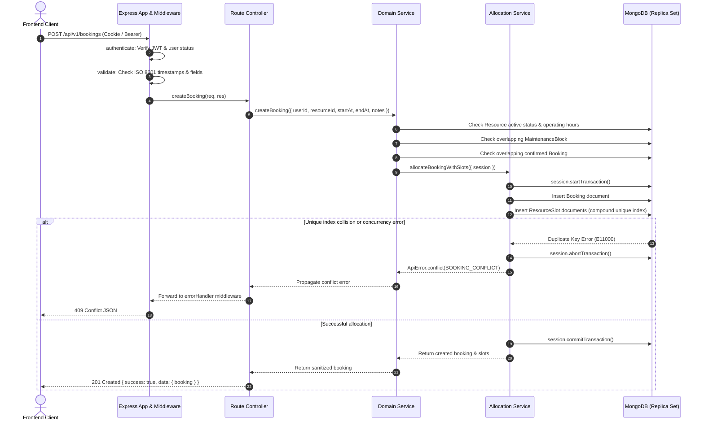
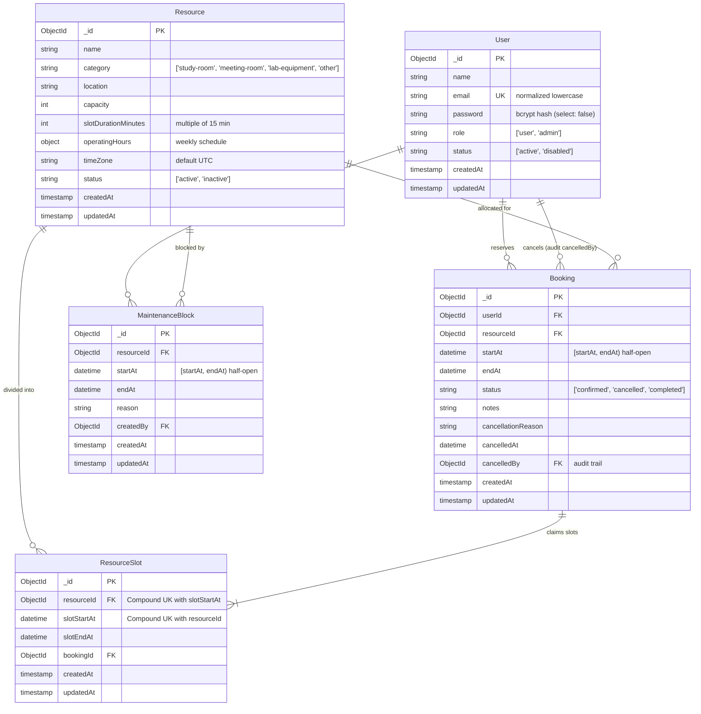

# Application Architecture

## 1. Client/Server Separation

The Smart Resource Booking System is engineered as a decoupled full-stack architecture within an npm workspaces monorepo:

- **Client Presentation Layer (`client/`):** Built with React 19 and Vite 6, using React Router 7 for declarative routing and a centralized API service in `client/src/services/apiClient.js` for HTTP communication. The client provides immediate user feedback and handles responsive layout presentation, but is never authoritative for booking rules, slot alignment, authorization, or availability calculations.
- **Server Application Layer (`server/`):** An Express (v5) application exposing the versioned REST API at `/api/v1`. The server strictly enforces input validation, authentication and role-based access control, resource scheduling rules, maintenance blackout checks, and persistence through Mongoose and MongoDB.

Client and server configurations are supplied through isolated local `.env` files; repository `.env.example` templates contain safe non-secret placeholders only.

---

## 2. Implemented Backend Architecture & Layer Responsibilities

The backend follows a strict layered architecture where each layer has a distinct responsibility:

```text
HTTP Request
     │
     ▼
[ Express Application (app.js) ]
  ├── Security Headers (nosniff, DENY)
  ├── CORS Origin Validation (CLIENT_URL)
  ├── JSON Body Parser (100kb limit)
  ├── Cookie Parser (signed/unsigned cookies)
  └── Lightweight Request Logger (logger.js)
     │
     ▼
[ API Master Router (routes/index.js) ] (/api/v1)
     ├── /health                 ──> Health Router
     ├── /auth                   ──> Authentication Router
     ├── /resources              ──> Public & Admin Resource Router
     ├── /bookings               ──> Authenticated Booking Router
     ├── /admin/resources        ──> Admin Resource & Maintenance Router
     ├── /admin/bookings         ──> Admin Booking Inspection & Cancellation Router
     ├── /admin/maintenance      ──> Admin Maintenance Deletion Router
     └── /admin/analytics        ──> Admin Analytics Summary Router
     │
     ▼
[ Cross-Cutting Middleware ]
  ├── authenticate.js     (Extracts JWT from cookie or Bearer header; verifies active account)
  ├── requireRole.js      (Enforces role authorization: 'admin' or 'user')
  └── validate.js         (Executes declarative schema validation rules)
     │
     ▼
[ Controllers ]
  Translate HTTP requests, parse query/body/params, invoke domain services, and return standardized JSON envelopes.
     │
     ▼
[ Domain Services ]
  Enforce core business logic, schedule calculations, conflict checks, and coordinate transactional persistence.
  ├── auth.service.js             (Credential verification, password hashing, JWT signing)
  ├── resource.service.js         (Resource discovery, catalog search, pagination, status lifecycle)
  ├── availability.service.js     (Candidate slot generation, operating hours filtering, blackout/booking exclusions)
  ├── bookingAllocation.service.js(Slot grid alignment, atomic multi-slot allocation primitives, session handling)
  ├── booking.service.js          (Reservation creation, user history, detail inspection, cancellation, reschedule)
  ├── maintenance.service.js      (Maintenance blackout CRUD, conflict detection with confirmed bookings)
  └── adminAnalytics.service.js   (High-level operational metrics using memory-efficient MongoDB aggregations)
     │
     ▼
[ Mongoose Models & Persistence ]
  ├── User.js                     (Normalized emails, bcrypt hashes, role-based authorization)
  ├── Resource.js                 (Capacity, slotDurationMinutes, weekly operatingHours, active status)
  ├── Booking.js                  (Half-open intervals [startAt, endAt), status, cancellation audit trail)
  ├── ResourceSlot.js             (Atomic slot allocation with unique compound index: resourceId + slotStartAt)
  └── MaintenanceBlock.js         (Blackout intervals [startAt, endAt) with range overlap indexes)
     │
     ▼
[ MongoDB Database ]
  Multi-document transactions executed via Mongoose client sessions on replica set or sharded cluster topologies.
```

---

## 3. Architecture Sequence Diagram



---

## 4. Domain Entities & Relationships

The application domain models five interconnected entities:



---

## 5. Core Invariants & Business Rules

### 5.1 Half-Open Intervals
All reservations, operating schedules, candidate slots, and maintenance blackouts operate on half-open intervals: `[startAt, endAt)`.
Two intervals `A` and `B` overlap if and only if:
```text
A.startAt < B.endAt && A.endAt > B.startAt
```
Adjacent intervals (e.g., `A.endAt === B.startAt`) do not overlap and are valid.

### 5.2 Slot-Grid Alignment
A requested reservation `[startAt, endAt)` must align strictly with the resource's `slotDurationMinutes` grid anchored to the day's configured opening time:
- `(startAt - openInstant) % slotDurationMs === 0`
- `(endAt - startAt) % slotDurationMs === 0`
- `startAt >= openInstant` and `endAt <= closeInstant`
- Single bookings spanning multiple contiguous increments allocate one `ResourceSlot` per fixed duration. Partial or unaligned intervals are rejected.

### 5.3 Operating Hours and Time Zones
Availability, booking creation, rescheduling, and maintenance management share an identical interpretation of resource operating hours.
Timestamps are stored and transferred as UTC ISO 8601 instants. Operating schedules are evaluated consistently against the resource's configured schedule without relying on the host server's local machine time zone.

### 5.4 State Transition Rules
- Valid booking statuses: `confirmed`, `cancelled`, and `completed`.
- Cancellation is permitted only for `confirmed` reservations whose start time is in the future (`startAt > now`). Past or completed bookings reject cancellation.
- Cancelled bookings preserve full audit history (`cancelledAt`, `cancellationReason`, `cancelledBy`) while their allocated `ResourceSlot` records are immediately released.
- Cancelled bookings never block availability or future reservations.

---

## 6. Concurrency Safety and Transaction Architecture

The system uses a defense-in-depth model combining application pre-checks, database uniqueness constraints, and transactional consistency:

1. **Pre-checks:** The service queries for overlapping maintenance blocks and confirmed bookings.
2. **Database Uniqueness Constraint:** The `ResourceSlot` collection enforces a unique compound index:
   ```javascript
   { resourceId: 1, slotStartAt: 1 } // unique: true
   ```
   Even if two concurrent requests pass application-level pre-checks simultaneously, the database permits only one transaction to insert the slot record. The second concurrent transaction encounters error code `11000` (duplicate key).
3. **Transactional Atomicity:** All writes (`Booking` creation/update and `ResourceSlot` creation/deletion) execute inside a Mongoose transaction session (`session.startTransaction()`). Any error rolls back all pending writes, preventing partial reservations or orphaned slots.
4. **Topology Requirement:** Multi-document transactions require a MongoDB deployment running as a replica set or sharded cluster. Standalone MongoDB instances do not support transactions; the service detects standalone environments and returns a clean `503 Service Unavailable` (`TRANSACTIONS_UNAVAILABLE`) rather than performing unsafe non-transactional writes.

---

## 7. Operational Readiness & Error Handling

- **Consistent JSON Envelopes:** Every endpoint responds using the standardized `{ success, message, data, meta }` or `{ success, message, code, details }` structure.
- **Centralized Error Normalization (`errorHandler.js`):** Translates Mongoose validation errors (`400 VALIDATION_ERROR`), duplicate key errors (`409 EMAIL_ALREADY_REGISTERED` or `BOOKING_CONFLICT`), JWT verification failures (`401 TOKEN_EXPIRED` or `TOKEN_INVALID`), CastErrors (`400 INVALID_ID`), and domain-specific `ApiError` instances.
- **Security & Privacy:** Password hashes are excluded via schema projection (`select: false`). Sensitive headers, authorization tokens, cookies, and database credentials are fully redacted from request logs. Stack traces are omitted in production environments (`NODE_ENV === 'production'`).
- **Health Diagnostic Endpoint:** `GET /api/v1/health` provides real-time verification of process liveness and MongoDB driver connectivity without leaking internal infrastructure details.
- **Operational Summary Endpoint:** `GET /api/v1/admin/analytics/summary` provides administrators with real-time aggregate counts calculated via database aggregations (`$facet`), requiring zero full-document memory loading.
